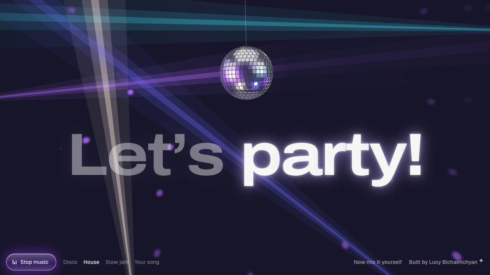

# Disco ball

Why do loading screens have to be boring? A mirror ball hangs over "Let's party!". Press **Play music** and the ball, the party lights and the words all move with the beat.

- Pick a mood: Disco, House or Slow jam. Each one is an original beat made in the browser.
- Play your own song. Choose a music file or drop one on the page. It is read on your own computer and is never uploaded.
- Drag the ball to spin it by hand, and flick it to keep it turning.

**[Try it live](https://lucybichakhchyan.github.io/disco-ball/)**

## How it is built

The page is `index.html`. The ball is `disco-ball.js`, a three.js module that adds its own styles. The browser makes the music with the Web Audio API, so there are no sound files. The page listens to the sound it plays, and that is what drives the lights.

## License

The code is available under the [MIT License](LICENSE).
