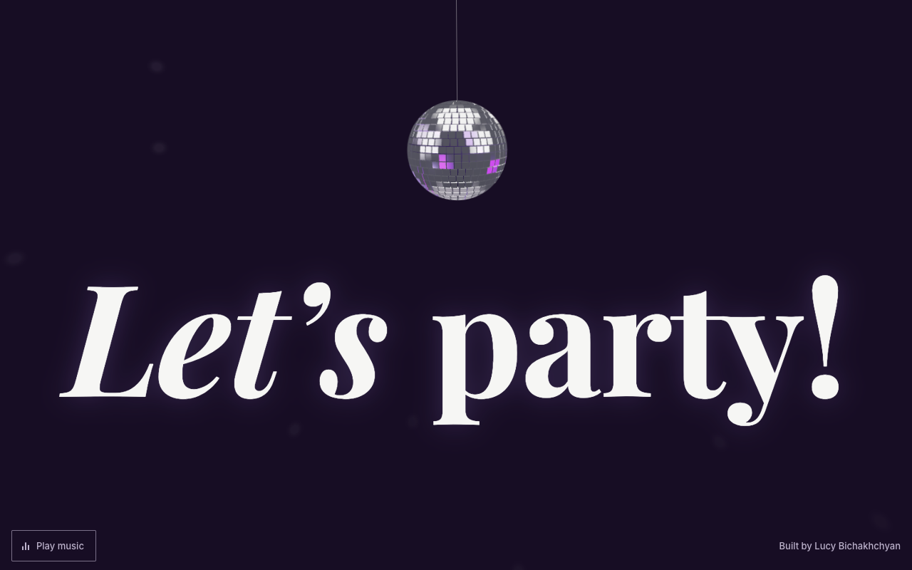

# Disco ball

Why do loading screens have to be boring? A mirror ball hangs over "Let's party!". Press **Play music** to start an original disco beat, made in the browser, and the moving party lights.

**[Try it live](https://lucybichakhchyan.github.io/disco-ball/)**

## How it is built

The page is `index.html`. The ball is `disco-ball.js`, a three.js module that adds its own styles. The browser makes the music with the Web Audio API, so there are no sound files.

## License

The code is available under the [MIT License](LICENSE).
